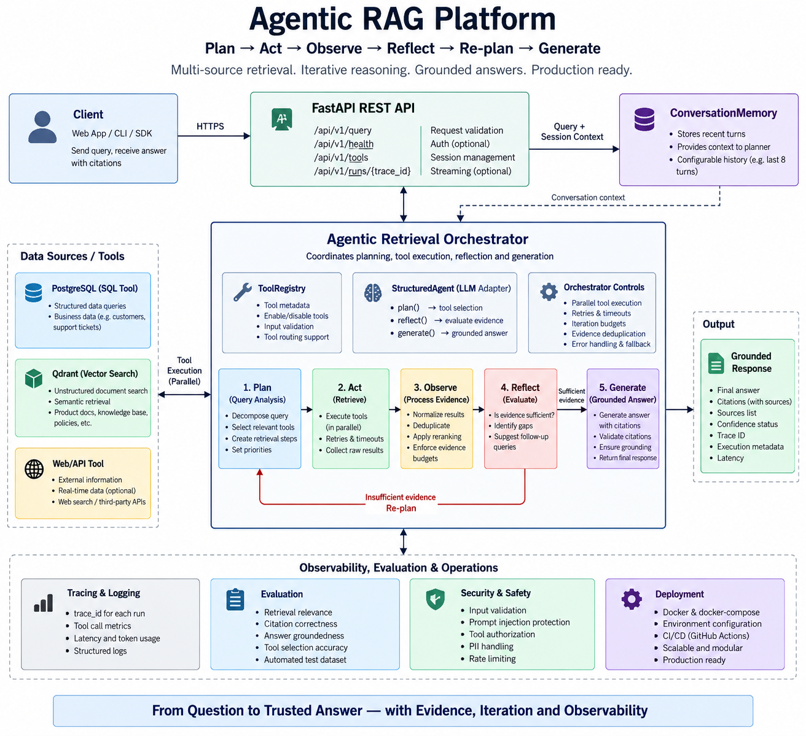

# Architecture

The runtime follows **Plan → Act → Observe → Reflect → Re-plan → Generate**.

```text
Client
  ↓
FastAPI
  ↓
Agentic Orchestrator
  ├─ Planner (LLM or deterministic fallback)
  ├─ Tool Registry
  │   ├─ SQL
  │   └─ Vector Search
  ├─ Parallel execution + retry + timeout budgets
  ├─ Evidence normalization / deduplication / reranking
  ├─ Reflector
  │    └─ insufficient evidence → follow-up plan
  └─ Grounded generator + citation validation
  ↓
Answer + trace metadata
```



The orchestrator intentionally keeps provider-specific model code behind `OpenAIStructuredAgent`, while tool implementations remain replaceable.
